# Kwery

Kwery is a relational database you can see into. Type SQL and run it, as you would with any
database, and then look inside: the plan the optimizer chose and what each operator cost, the
slotted pages the rows were written to, the buffer pool filling and evicting, the B+ tree the
index search walked down, the locks two transactions are waiting on, the log records a crash
leaves behind and how restart replays them. Everything runs in the browser, on a database
engine written for the purpose, so every one of those pictures is drawn from the real thing.

I have taught the database course for years, and the hard part has never been the SQL. It is everything underneath: why the optimizer picked a hash join, what "the page is
dirty" means, why one transaction waits and the other does not, what ARIES actually does on
restart. A real database hides all of that, on purpose. Kwery shows it, one step at a time, on
data small enough to follow and large enough to matter.

Live at https://kwery.jyotiprakash.org

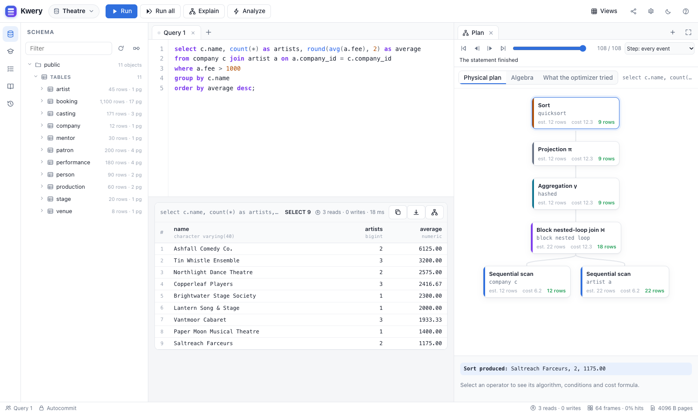

## What it is

Kwery is one HTML file. There is nothing to install and nothing is sent anywhere; your
databases, tabs and progress are kept in the browser. Under the page is a database engine in
JavaScript with the layers of a real one: a SQL parser and binder, a cost-based optimizer, an
executor of pipelined operators, B+ tree, hash, bitmap, LSM and R-tree indexes, a buffer
manager over slotted pages on a simulated disk, multiversion concurrency control with locks,
a write-ahead log and crash recovery.

Its SQL is PostgreSQL's dialect, and its answers are tested against PostgreSQL 17: the same
statements are run on both, and the rows, column types, notices and error codes must agree.
That covers joins of every kind, subqueries in every position, set operations, recursive
common table expressions, grouping sets, window functions with frames, numeric, date, time,
interval, text, bytea, arrays, JSON and jsonb, composite, enum and domain types, sequences
and identity columns, constraints (deferrable ones too), views, triggers, functions and
procedures in a PL/pgSQL subset, MERGE, roles and privileges, and transactions with
savepoints, isolation levels and prepared commits. `psql` meta-commands such as `\d`, `\dt`
and `\df` work too.

The order of the material follows the chapters of *Database System Concepts* by Silberschatz,
Korth and Sudarshan, seventh edition, so a student can use Kwery beside the course text. Only the
order of topics and the standard terms are shared; the sample databases, lessons, exercises,
examples, pictures and wording are all my own, and nothing is taken from the book.

## The workbench

The editor is on the left, with tabs. Each tab is its own session, with its own transaction,
so two tabs are two users: begin a transaction in one, update a row, and watch the other one
wait. Ctrl+Enter runs the statement under the cursor; Shift+Ctrl+Enter or F5 runs the whole
tab. Results come back as tables, with the time taken, the rows, and the pages read and
written.

On the left is the schema: every table with its columns, keys, indexes and size, and a click
on any of them opens it in the right view. On the right is the dock, where each view of the
inside of the database opens in a tab of its own. The timeline at the bottom of the dock
records what happened while a statement ran, so you can step back and forward through it.

There are nine sample databases, all designed for Kwery. Theatre is the one used throughout
the lessons: companies that stage productions at venues, artists cast in them, patrons who
book performances and rate them. There is a small copy of it, with few enough rows to trace a
query by hand, and a large one with six thousand patrons and forty-five thousand bookings,
where indexes and join algorithms make a real difference. The others are a credit union with
accounts, cards and transfers for the transaction lessons, a software studio with a
reporting chain, a library, an airline, a shop with jsonb product attributes, and three days
of sensor readings for window functions. Any database can
be saved, shared as a link, exported as SQL, or loaded from a `.sql` or `.csv` file.

## Queries

The **Plan** view draws the plan the optimizer chose as a tree, with the estimated and the
actual rows of each operator, its cost and its time. Click an operator to see how its cost was
worked out, with the formula from the course (block transfers and seeks, tT and tS) and the
numbers put in. EXPLAIN and EXPLAIN ANALYZE print the same plan as text, in PostgreSQL's
format.

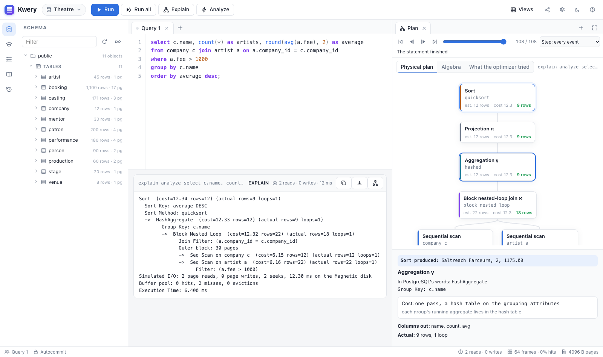

**Query anatomy** takes a query apart clause by clause in the order SQL evaluates it: the
rows FROM produces, the ones WHERE keeps, the groups GROUP BY makes, the ones HAVING keeps, the
columns SELECT computes, the order and the limit. Each step is a table of real rows.

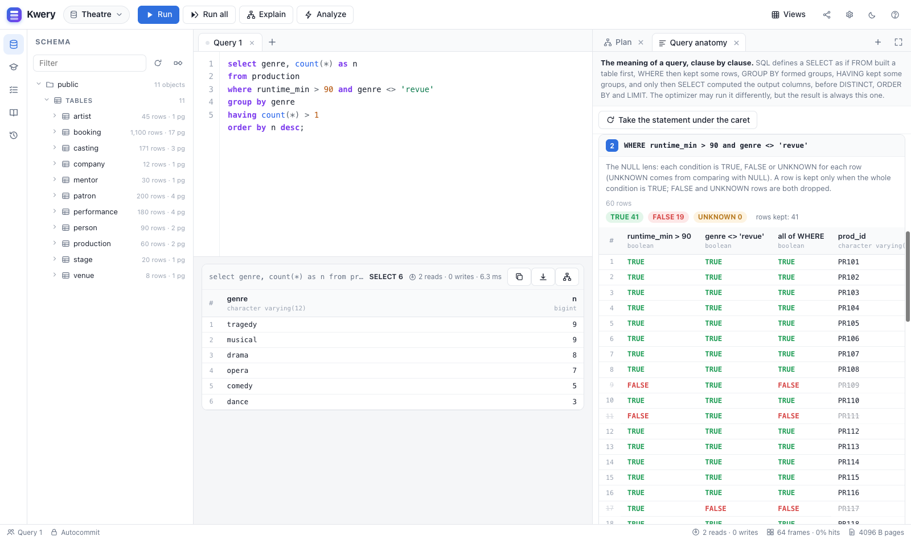

The **Processing lab** runs the same query with each join algorithm and access path the
engine has (nested loop, block nested loop, indexed nested loop, merge join, hash join;
sequential, index, bitmap and index-only scans), and charts what each one cost in blocks and
time, beside what the optimizer predicted.

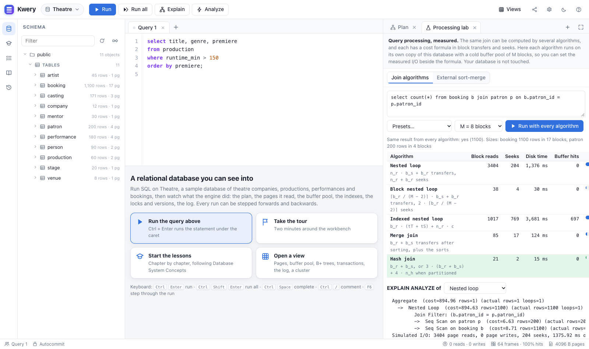

**Relational algebra** has its own editor: write an expression with σ, π, ⋈, ∪, −, ÷ and the
rest, see it as a tree and as the equivalent SQL, and run it on the same database.

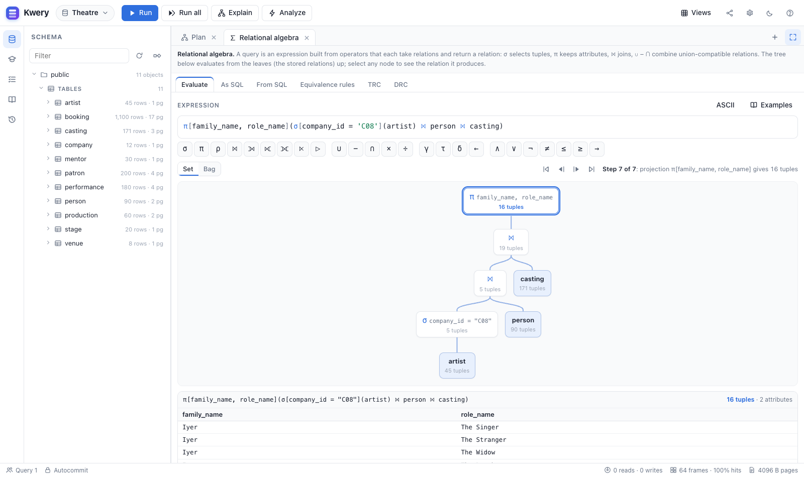

## Storage

The **Storage** view shows a table as the pages of its file, and opens a page to show its
header, its slot array growing from the front and its tuples from the back, with each tuple's
header (xmin, xmax, the null bitmap) and its bytes. Deleted and updated rows stay visible until
VACUUM takes them away.

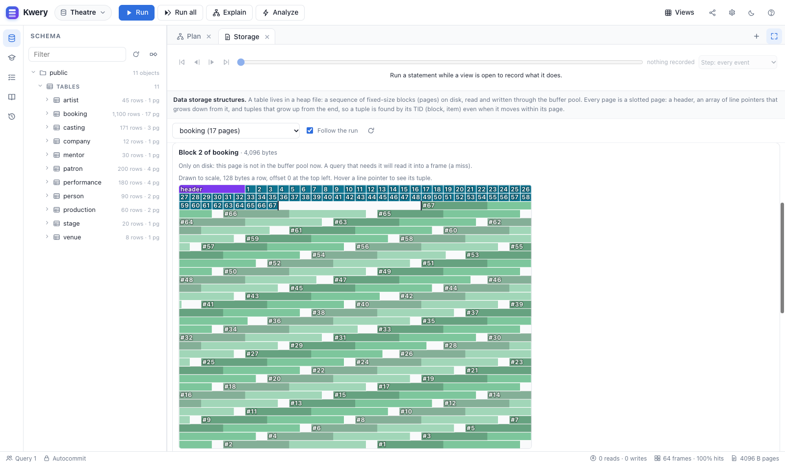

The **Buffer pool** view shows every frame: which page it holds, its pin count, whether it is
dirty, and the replacement policy at work (LRU, LRU-2, clock, FIFO or MRU) as a query runs. The **Disk** view models a hard disk or an SSD and shows what each access costs, and
**Row vs column** works out how many pages the same scan reads from a row store and from a
column store.

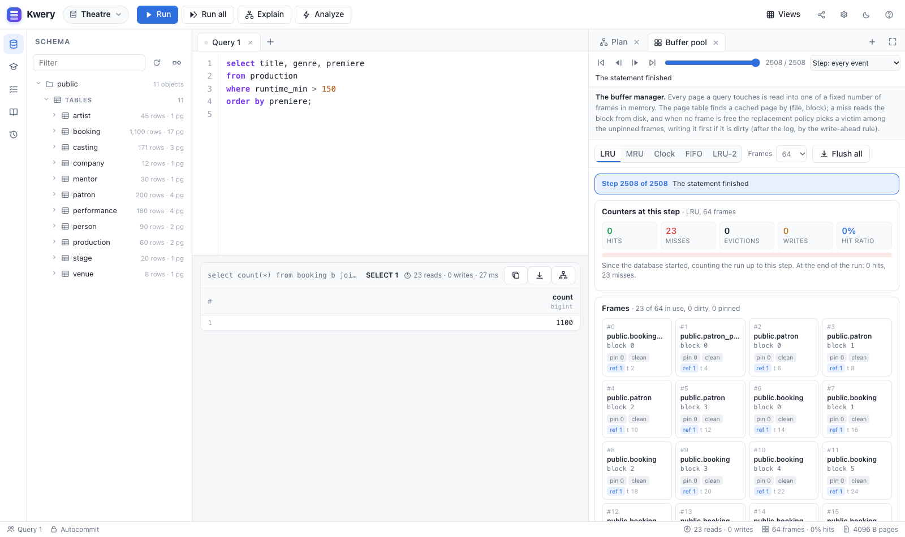

## Indexes

The **Index** view draws any index in the database as it is stored, node by node, and shows
which nodes a search, insert or delete touches. `CREATE INDEX ... WITH (fanout = 4)` makes a
B+ tree small enough to watch split.

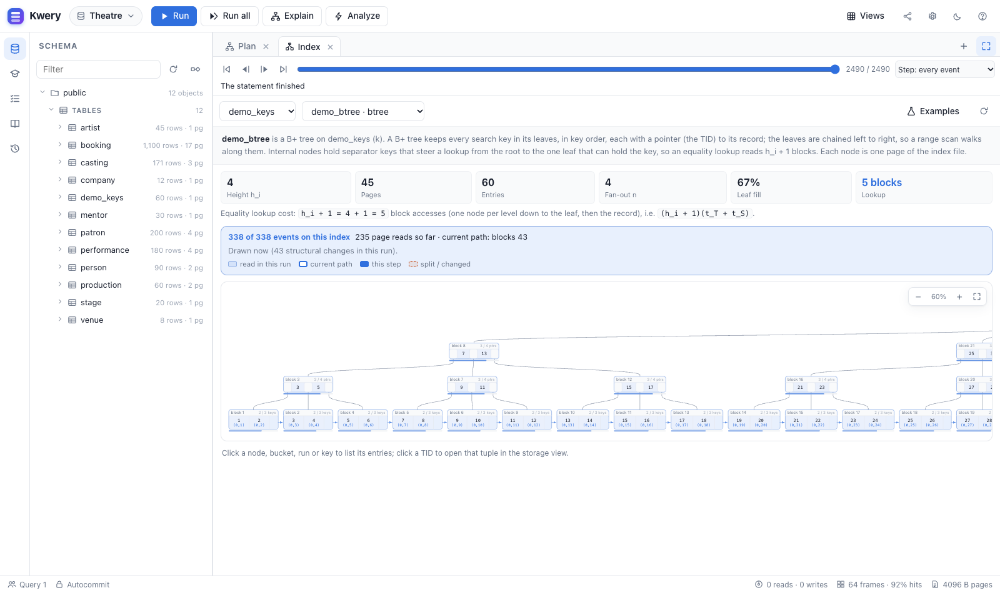

The **Index playground** takes keys one at a time and animates what they do: a B+ tree and a
B-tree splitting and merging, static, extendable and linear hashing, an LSM tree flushing and
compacting, bitmap indexes, and R-trees, k-d trees and quadtrees on a plane you click on. It
can run a B+ tree and a B-tree side by side, or count the page writes of a B+ tree against an
LSM tree. The **Bloom filter** view shows false positives arrive as the filter fills.

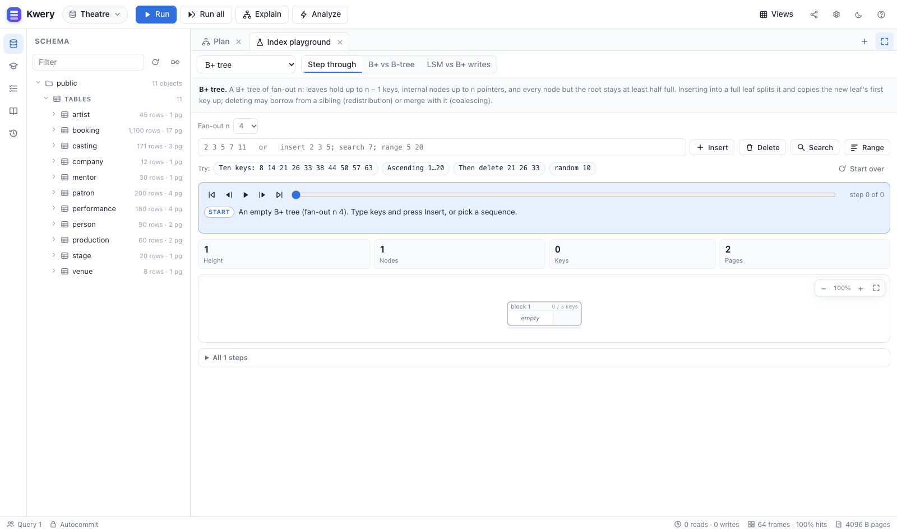

## Transactions and recovery

The **Transactions** view shows every transaction running in every tab: the locks it holds and
the ones it waits for, the waits-for graph with any deadlock in it, the snapshot it reads from
and the row versions it can and cannot see. The concurrency protocol can be switched from
PostgreSQL's own to the ones in the course: two-phase locking (basic, strict, rigorous),
timestamp ordering with or without Thomas' write rule, validation, multiversion timestamp
ordering, multiversion two-phase locking, and serializable snapshot isolation. Ready-made
scenarios set up a lost update, write skew, a deadlock or a phantom in two tabs.

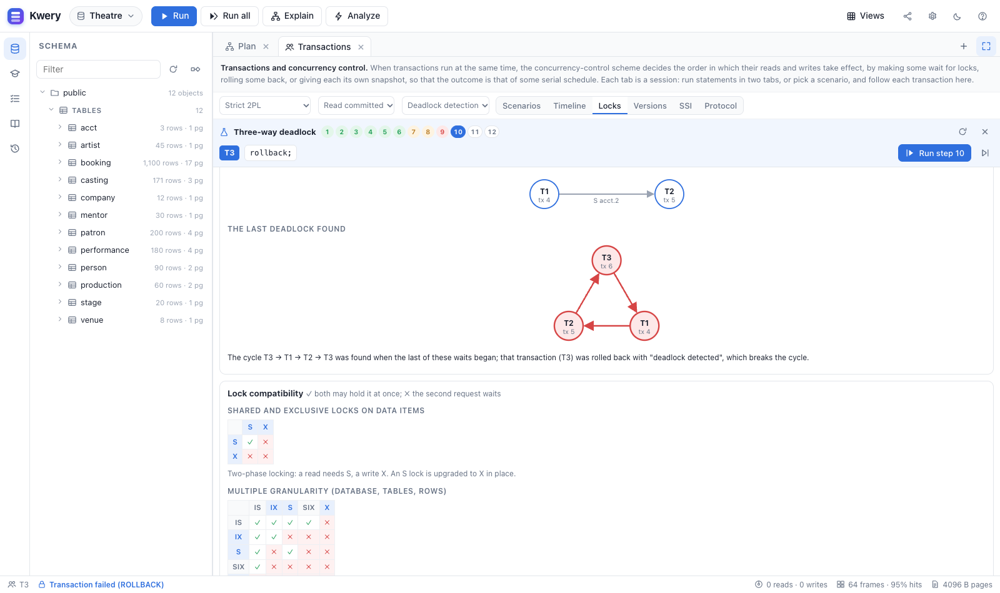

**Schedules** takes a schedule of reads and writes and draws its precedence graph, says
whether it is conflict serializable, view serializable, recoverable and cascadeless, and runs
it under each protocol to show which operations wait, which abort and why.

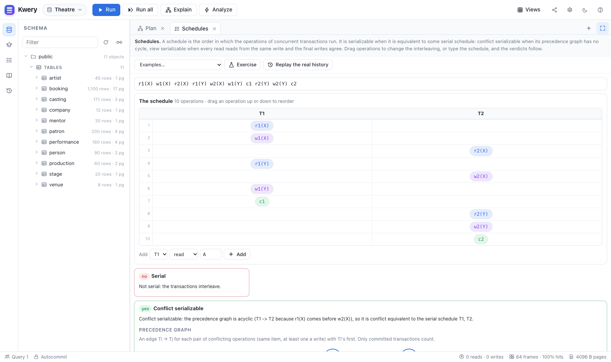

The **Log** view lists the write-ahead log record by record, each decoded with its before and
after values. **Crash and recovery** crashes the database at a moment you choose, with
committed and uncommitted work in flight, and then restarts it, either with the basic
redo-then-undo algorithm or with ARIES's analysis, redo and undo passes, one record at a time:
the transaction table, the dirty page table, each page's LSN, the compensation records. First
you predict which changes will survive.

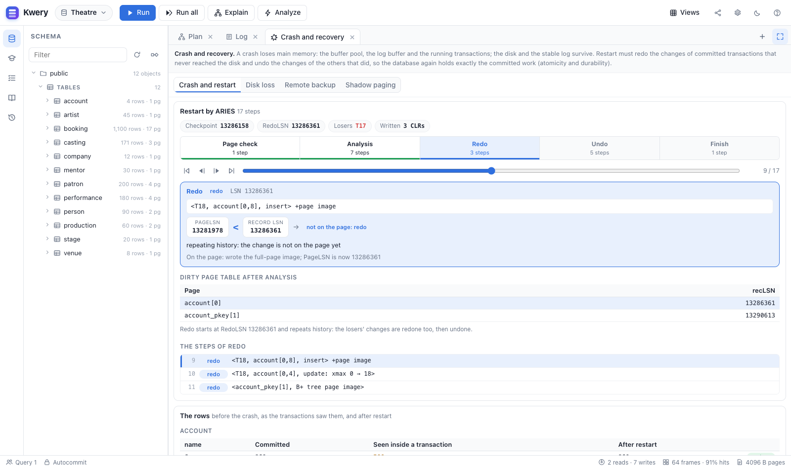

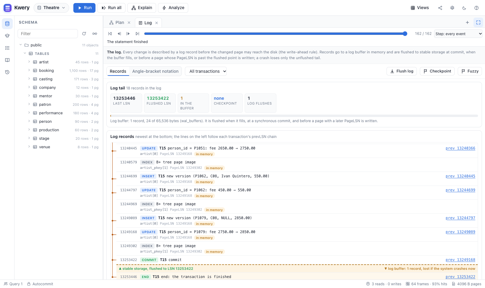

## Design

The **E-R diagram** view is an editor for entity-relationship diagrams in the notation of the
course: entity sets, relationship sets, attributes of every kind, cardinality and
participation, weak entity sets, specialization and generalization. It turns a diagram into
tables, and the **Schema diagram** draws the tables of any database with their keys and
foreign keys.

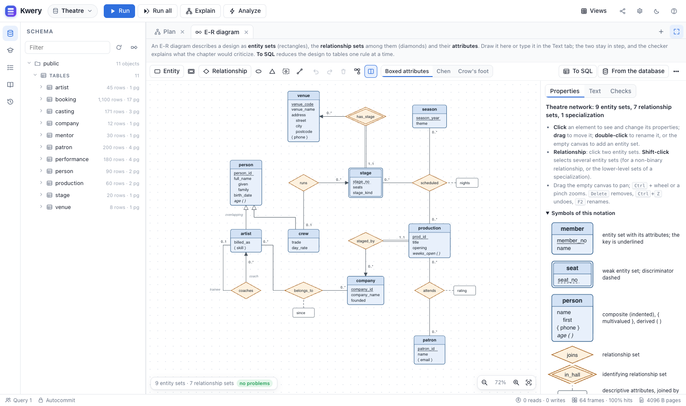

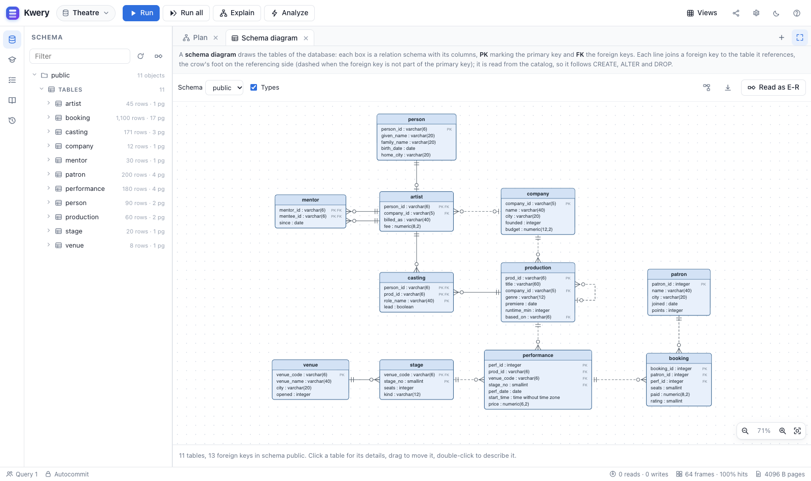

**Design theory** works with functional dependencies: closures of attribute sets and of sets
of dependencies, candidate keys, canonical covers, tests for BCNF and third normal form, and
the decomposition algorithms, step by step, with lossless-join and dependency-preservation
checks, and the anomalies a bad design lets in, shown on rows.

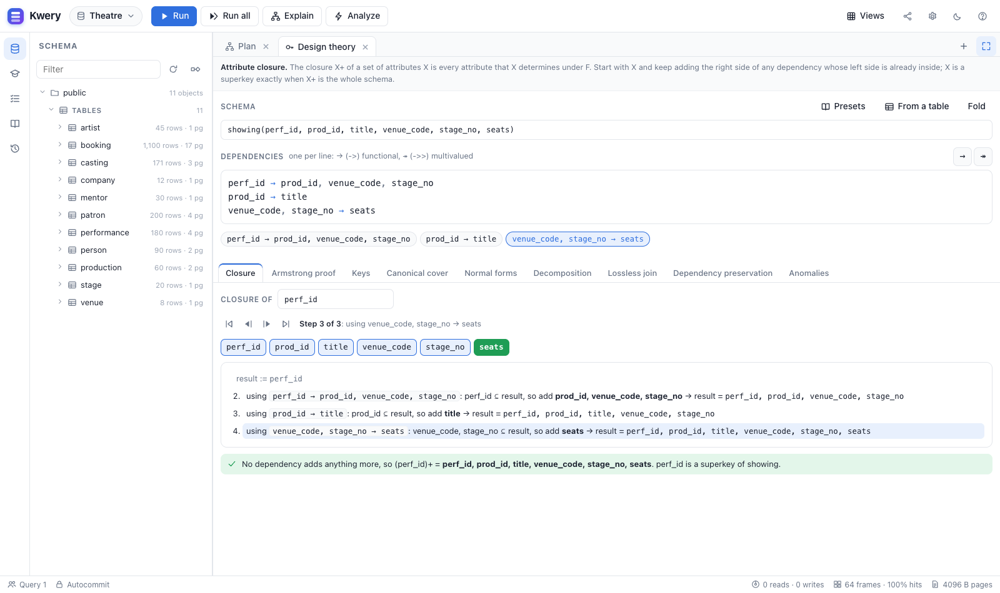

## Distributed databases

The **Cluster** view runs a cluster of nodes on a simulated network that you can partition,
slow down and crash. On it run partitioning by range and by hash with consistent hashing,
primary-copy, multi-master and quorum replication, two-phase and three-phase commit,
distributed deadlock detection, Raft, and a demonstration of the CAP theorem. Each message is
drawn as it travels. **Distributed query** splits a query into fragments across nodes, with
exchange operators that repartition, broadcast and gather, and **MapReduce** runs map and
reduce jobs on the same nodes. **Architectures** compares the speed-up and scale-up of shared
memory, shared disk and shared nothing.

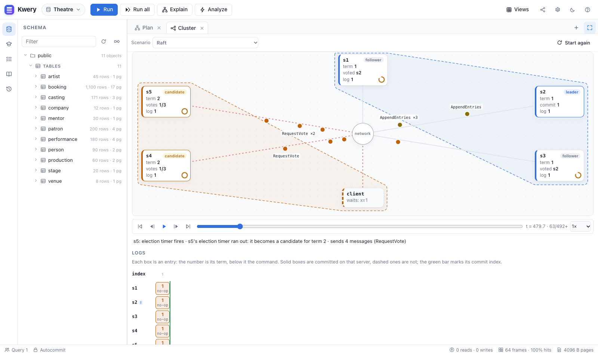

## Beyond the core

**Blockchain** mines blocks with a real SHA-256, shows a Merkle proof, lets you tamper with a
block and see every block after it break, forks the chain, and compares it with a replicated
database under Raft. **Tuning** suggests indexes for a workload and runs a small benchmark of
new-order transactions with one to eight clients under two isolation levels. **Data cube**
drills down, rolls up, slices and pivots, and shows the GROUP BY CUBE query behind each view.
**Streams** puts tumbling, hopping and session windows over a stream of late and out-of-order
events. **Programs** runs JavaScript against the database through a small JDBC-like API, to
show prepared statements, SQL injection and its fix, and the N+1 queries problem.

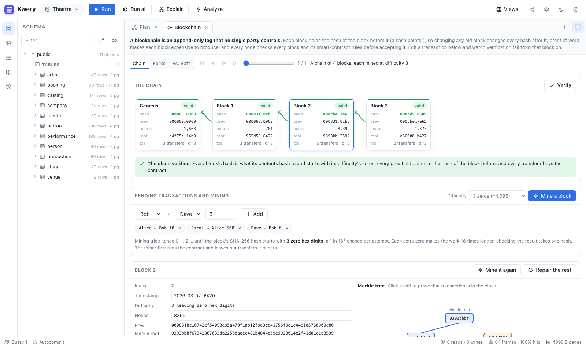

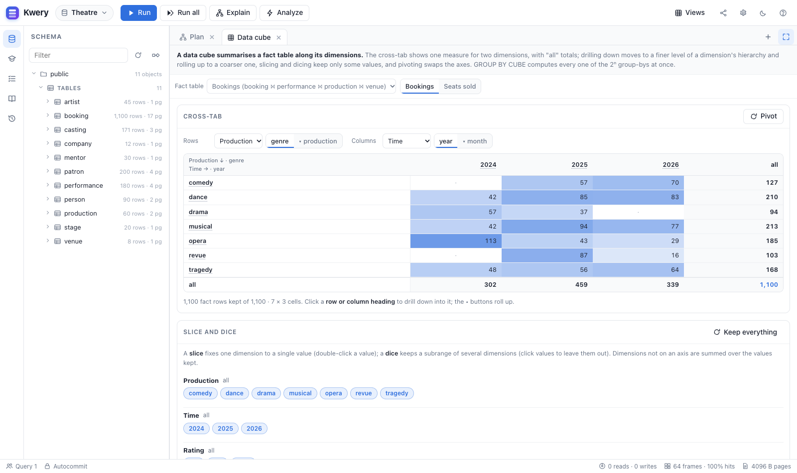

## Lessons, exercises and tours

There are lessons for all 26 chapters. A lesson explains one idea and gives SQL to run, a view
to open and something to look for, and the examples run in the editor beside it with a click.

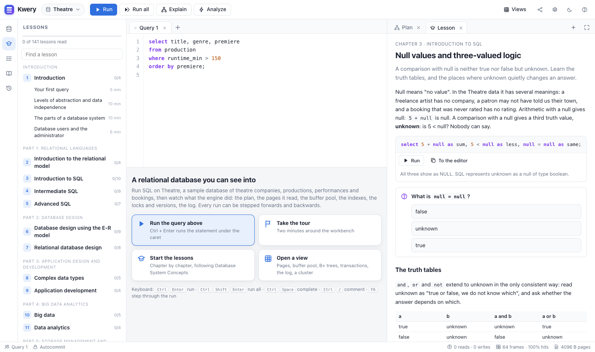

There are exercises for every chapter: queries to write, plans to predict, schedules to judge,
dependencies to analyse, logs to recover by hand. A SQL answer is checked by running it, not
by comparing text: it must give the right rows on the sample database and also on altered
copies of it (an artist with no company, a company with nobody in it, two patrons with the
same name), so a query that only happens to work on the data in front of it is
caught. Each exercise has three hints, the last one the worked answer.

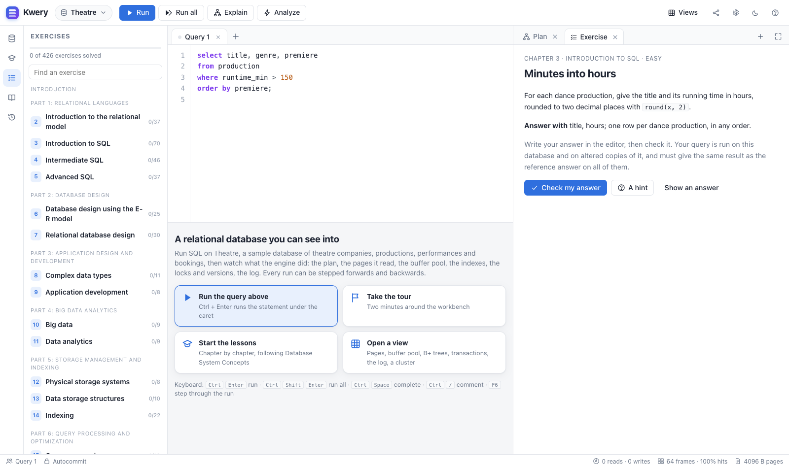

Tours walk through one thing from start to finish, a view at a time: a SQL statement down to
the pages it touches, a page split in a B+ tree, a deadlock and its victim, a crash and an
ARIES restart, a cluster rebalancing, and a Raft election. The **Reference** lists every
statement, function, operator, type and setting Kwery supports, with an example of each that
runs.

## Looks

There is a dark and a light theme, and the first visit follows the system setting. The dock
can take the whole window when a view needs room, and every view works on a phone, with the
schema and dock as panels you slide in.

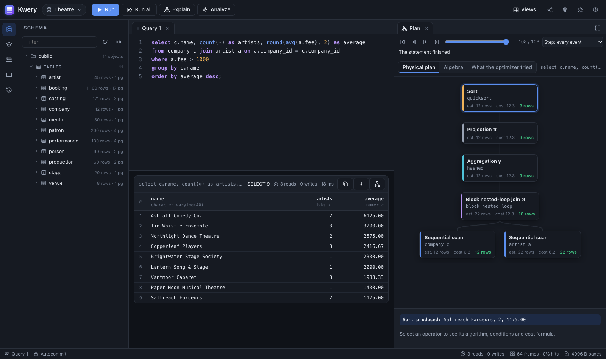

<p>
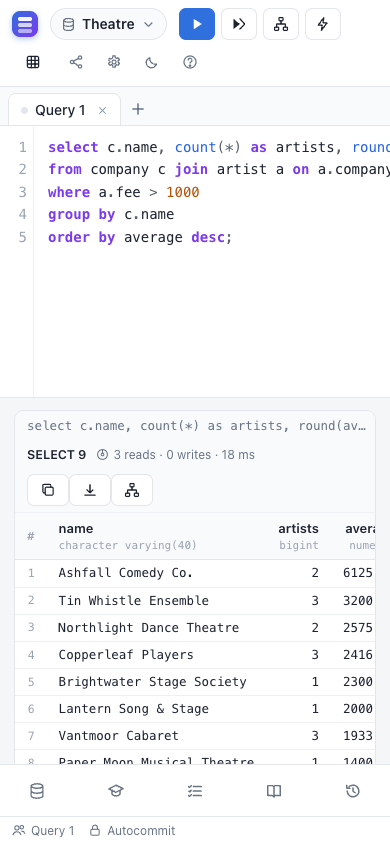
</p>

## Keyboard

| Key | Does |
| --- | --- |
| Ctrl+Enter | run the statement under the cursor |
| Shift+Ctrl+Enter, F5 | run the whole tab |
| Ctrl+Space | complete a table, column or keyword |
| Ctrl+/ | comment or uncomment the lines |
| Ctrl+S | save the tabs in this browser |
| F6, Shift+F6 | step forward or back through the timeline |

On a Mac, Cmd works in place of Ctrl.

## Running it locally

Kwery is the single file `index.html`, with the larger sample databases in `data/`. Open it
from any web server:

```
python3 -m http.server 8000
```

and go to http://localhost:8000. To change it, edit the files under `src` and run

```
node build.mjs
```

which joins the sources listed in `src/manifest.json` into `index.html`. The build also loads
every sample database once and stores it as a snapshot of its pages, so that a sample opens in
milliseconds instead of being built row by row; the first is inside `index.html`, the others
are in `data/` and are fetched when chosen.

## Testing

The engine is tested against PostgreSQL. `tests/sql` holds over six thousand statements in files
by topic; `node tests/conform.mjs` runs each file on Kwery and compares the rows, column types,
notices and SQLSTATE error codes with the output PostgreSQL 17 gave for the same file, kept in
`tests/sql/.expected`. `--refresh` makes new expected output from a local PostgreSQL 17 server,
reached only through its Unix socket.

The other suites test the parts that PostgreSQL does not have: `cc` and `protocols` the
concurrency protocols and isolation anomalies, `recovery` crashes at every point of a
workload under both recovery algorithms, `index` every index structure against a sorted
array, `schedule` and `algebra` and `normal` the theory, `cluster` the network simulator,
replication, commit protocols and Raft, and `samples` every sample database.
`node tools/check-content.mjs` runs every lesson and checks every exercise: that its answer
passes on all the copies of the data, and that its wrong answers fail.

`node tests/e2e/run.mjs` runs the end to end tests in headless Chrome: every view, the tours
step by step, the lessons and exercises, and phone-sized screens.

## Project layout

```
src/engine     the database: parser, binder, planner, executor, access methods, storage, transactions, recovery
src/theory     relational algebra, schedules, functional dependencies and normalization
src/er         the E-R model and its translation to tables
src/cluster    the network simulator, replication, commit protocols, Raft, distributed queries, MapReduce
src/ui         the page: editor, results, schema, dock, lessons, and the views
src/content    the chapters, lessons, exercises, tours and reference
src/data       the sample databases as SQL
data           the packed sample databases the page fetches
tests          the engine, theory and cluster tests, and the end to end tests
tools          the sample generators, the content checker, the Chrome driver, screenshots
```

## Limitations

Kwery is for learning, not for keeping data. It holds a database in memory, and in the
browser's storage between visits, so databases of a few tens of thousands of rows are
comfortable and much more is slow. Its SQL is a large part of PostgreSQL's but not all of it:
there are no foreign data wrappers, no full-text search, no extensions, and PL/pgSQL is a
subset. Times and costs come from a model of a disk, not from your machine's, so that they
are the same for everyone and match the formulas in the course.

## Trademarks

PostgreSQL is a registered trademark of the PostgreSQL Community Association of Canada. Chrome
is a trademark of Google LLC, Safari is a trademark of Apple Inc., Firefox is a trademark of
the Mozilla Foundation, and GitHub is a trademark of GitHub, Inc. *Database System Concepts*
is a book by Abraham Silberschatz, Henry F. Korth and S. Sudarshan, published by McGraw Hill.
These names are used only to describe compatibility and the order of the material. Kwery is an
independent work and is not affiliated with or endorsed by any of them.

## License

Kwery is free software under the GNU General Public License, version 3 or later. See `LICENSE`
for the full text and `COPYRIGHT` for the notice.

Under section 7 of the license there is one additional term, written out in full in `NOTICE`.
Any copy, modification or derived work, including a hosted version, must keep the attribution
"Based on Kwery by Jyotiprakash Mishra (https://kwery.jyotiprakash.org)" in its source and
show it in its about screen or other legal notices. This applies to the program, the lessons,
exercises and tours, and the sample databases.

Copyright (C) 2026 Jyotiprakash Mishra
